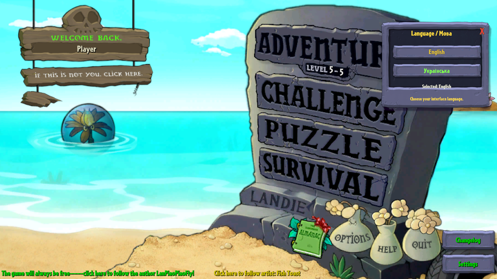

# PvZ Fusion Co-op

Two-player LAN co-op for **PvZ Fusion 4.1 (Windows, IL2CPP)**. Defend the same lawn in the normal campaign.

[Download the mod](https://github.com/dwdwqdwq/pvz-fusion-coop/releases/latest/download/PvZ-Fusion-Coop-0.11.0.zip) · [Українською](README.uk.md)

## Features

- Normal campaign co-op, shared sun, planting arrows and a compact teammate card preview with cooldowns.
- Card selection distinguishes the normal card from Fusion's more expensive extra copy. The same real slot cannot be selected twice across the two decks.
- Manual host IP and TCP port (default `27650`). No Steam account is required for LAN play.
- **Original English or Ukrainian interface**, selectable from **LANGUAGE** in the main menu. The choice is saved; restart the game to apply it. English is the public version's default.
- Ukrainian menu artwork, adapted font, plant/zombie names and descriptions. Longer reference text includes machine translation and may need further editing.



## Install

This is a mod, not a full game download. Use an existing compatible **Fusion 4.1 with BepInEx IL2CPP**. Run it once so BepInEx generates `interop` files.

Close the game, extract the release ZIP into its folder, then launch the game normally. The archive places `PvZCoop.dll` and the required managed `Steamworks.NET.dll` in `BepInEx/plugins/PvZCoop/`. It contains no game executable, Unity runtime, game data, saves, or BepInEx loader.

Both players should install the same release. Languages may differ between players. Existing co-op 0.10.2 uses the same LAN protocol; a matching public release on both PCs is recommended.

## Play

1. Connect both PCs to the same LAN. For remote play, join the same **Radmin VPN** or **ZeroTier One** virtual network.
2. Open **CO-OP**. The host chooses a TCP port and creates a game. A blank bind IP listens on all local interfaces.
3. The second player enters the host PC's LAN IP (or its **VPN IPv4 address** for remote play) and the same port, then joins.
4. The host closes the panel and chooses a normal level. Both players choose cards and press **READY**.

If connecting fails, check that the host IP is its current LAN adapter address, both ports match, and the game's network access is allowed on your private network. This mod does not include Internet matchmaking or a relay.

## Language

Open **LANGUAGE** at the top right of the main menu and select **English** or **Українська**. Restart to apply the selection. You can also set `[Language] Interface = en` or `uk` in `BepInEx/config/pvzfusion.coop.cfg` while the game is closed. Language settings are local and do not alter network messages or saves.

## Build

Install .NET SDK 8 or newer. Build references come from your own compatible game installation; game assemblies are not stored in this repository.

```powershell
./build.ps1 -GameDir 'D:/Games/Fusion-4.1'
```

The result is `src/bin/Release/net6.0/PvZCoop.dll`. Building does not install it. `Steamworks.NET.dll` must already be in the game's plugin directory as described above.

Release archive: `./pack-release.ps1 -GameDir 'D:/Games/Fusion-4.1'`.

Tests: `dotnet run --project tests`. See [verification](docs/VERIFICATION.md) for actual runtime checks.

## Credits and scope

PvZ, Fusion, the original game artwork/font and referenced game data belong to their respective creators. Ukrainian menu artwork was redrawn from the game's visual references; the font is adapted from the game font. Co-op UI sprites include material from the supplied Chinese ecology mod. This is an unofficial fan modification and makes no claim to those assets.

Co-op adaptation and Ukrainian localization developed with OpenAI Codex. No blanket license is asserted over pre-existing third-party code or game-derived assets. Steamworks.NET retains [its own MIT license](https://github.com/rlabrecque/Steamworks.NET/blob/master/com.rlabrecque.steamworks.net/LICENSE.md), included with the release dependency. BepInEx/Il2CppInterop are external dependencies under their own licenses.
